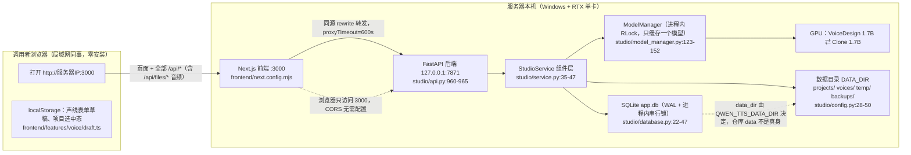
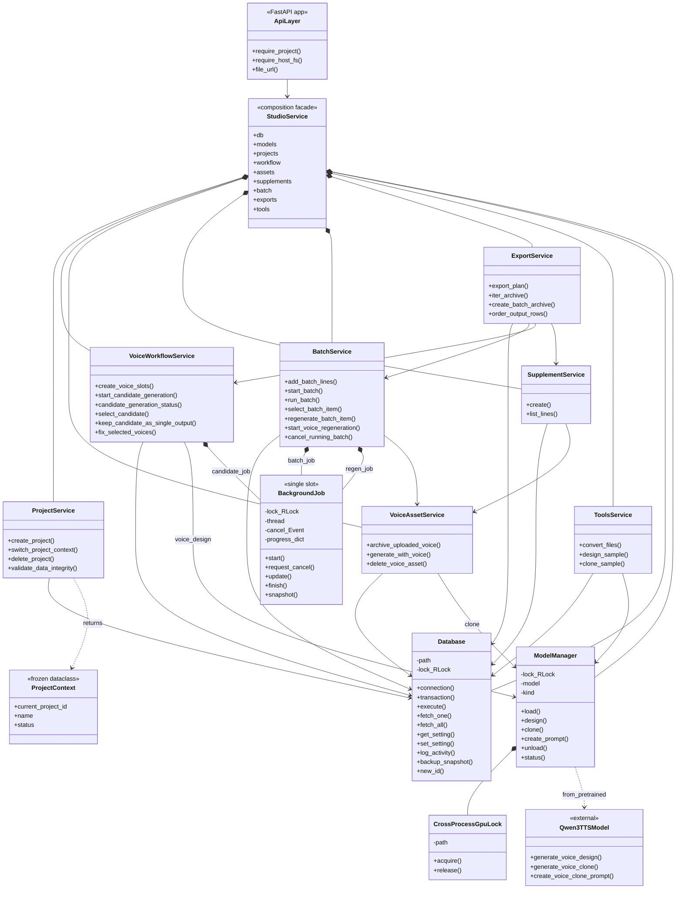
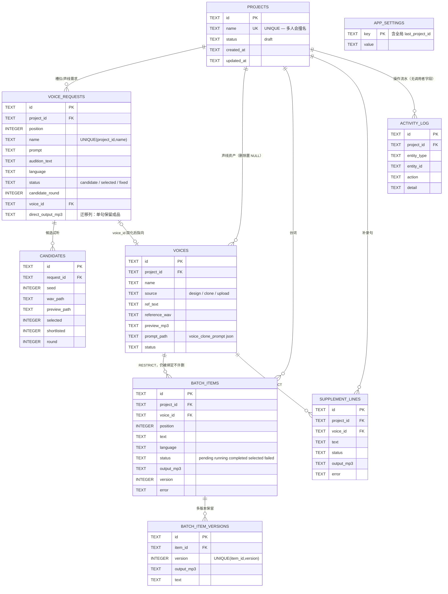
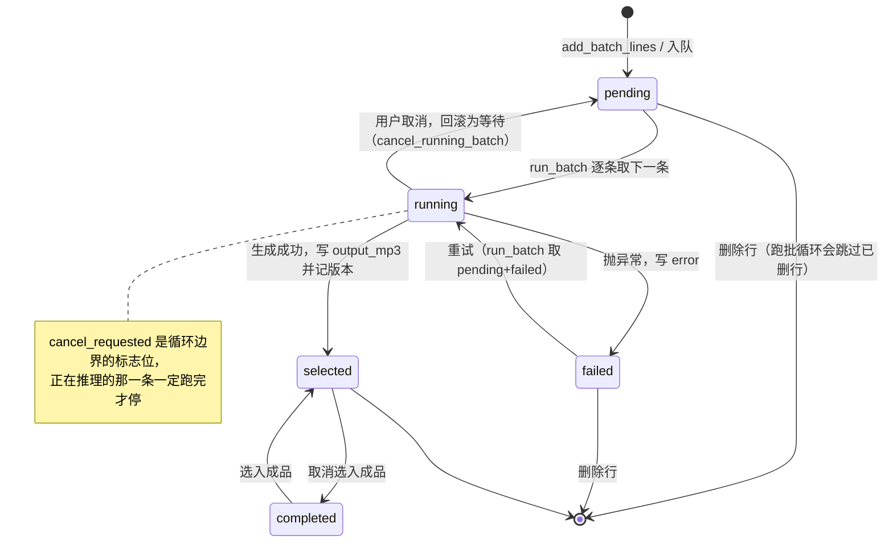
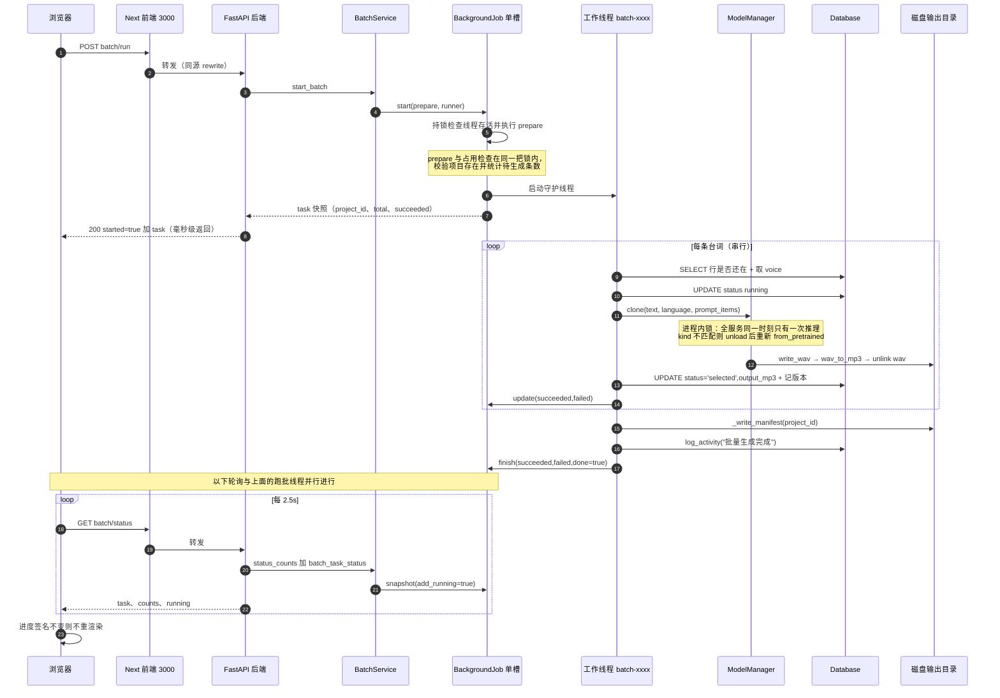
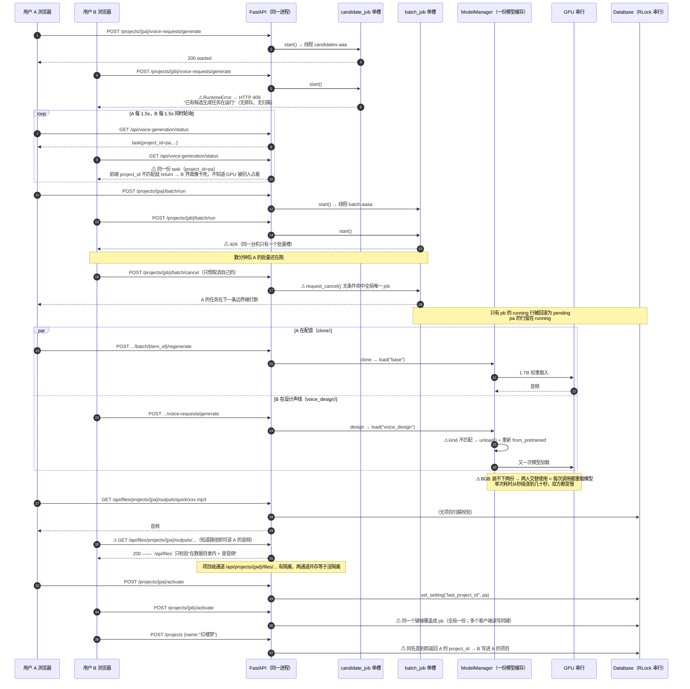
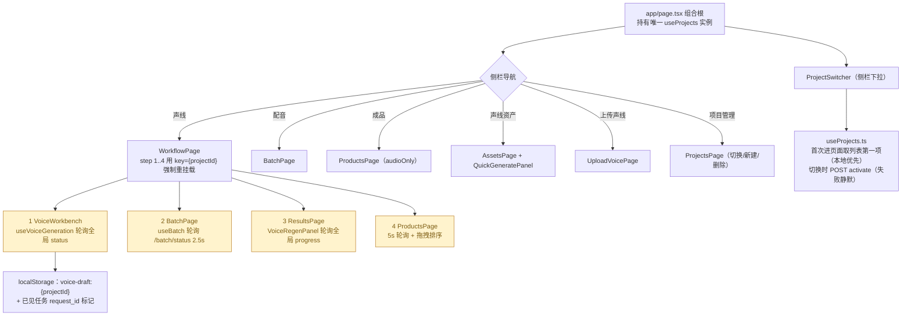

# 架构图集（Mermaid 源码）

> 图里的每个节点、每条依赖都对应仓库里的真实代码，标注格式为 `文件:行号`。
> 在支持 Mermaid 的查看器（IDE 预览、GitLab/GitHub 网页）里会直接渲染成图形。

目录：

1. [部署形态与请求链路](#1-部署形态与请求链路)
2. [项目业务流程图（工作台主链路）](#2-项目业务流程图工作台主链路)
3. [UML 类图：后端组件划分](#3-uml-类图后端组件划分)
4. [UML ER 图：数据模型](#4-uml-er-图数据模型)
5. [UML 状态图：批量台词项](#5-uml-状态图批量台词项)
6. [UML 时序图：单人跑一条批量任务](#6-uml-时序图单人跑一条批量任务)
7. [UML 并发时序图：多人同时使用（含现有缺陷）](#7-uml-并发时序图多人同时使用含现有缺陷)

---

## 1. 部署形态与请求链路

一台 Windows 主机同时是开发机和部署机；对外只开 3000，后端 7871 只绑本机回环。

要点：

- 浏览器只访问 3000，所以 **CORS 无需配置**，后端换绑定地址也不影响同事使用。
- 成品交付走两条不同路径：**ZIP 流式**（`/api/projects/{project_id}/outputs/archive.zip`，`studio/api.py:823-844`，服务器不留文件）和**浏览器写盘**（`export-plan` 出清单 + `showDirectoryPicker`，`studio/api.py:847-865`、`frontend/lib/localExport.ts:69`）。
- 写服务器本机磁盘/弹目录框的接口默认关闭，靠 `QWEN_TTS_ALLOW_HOST_FS` 收口（`studio/api.py:60-73`）。

---

## 2. 项目业务流程图（工作台主链路）

> 2026-10-16 按现行代码重绘。旧版流程图已过时：接口路径写成了不存在的
> `voice-slots`（实际是 `voice-requests`），且未体现「新建项目两种方式决定落点」这条规则。

### 2.1 创建项目：两种方式决定落点

新建向导（`frontend/features/projects/NewProjectWizard.tsx`）第一步只有两种方式，
**落点由此确定**（`frontend/features/projects/useProjects.ts` 的 `createProject` /
`consumeEntryStep`，组合根在 `frontend/app/page.tsx` 的 `openProject` 消费）：

| 方式 | 含义 | 勾选声线 | 落点 |
|------|------|----------|------|
| A | 创建新声线 | 否 | 第 1 步（创建声线） |
| B | 使用已有声线 | 是（至少 1 个） | 第 2 步（配音生成） |

进入**既有**项目（侧栏、总览页「进入」）一律落第 2 步。
项目在向导完成时才真正创建；方式 B 挂载声线只建 `project_voices` 关联，不复制音频文件。

### 2.2 主干链路

```mermaid
flowchart TD
    S0["新建项目向导<br/>输入名称 + 选方式"] --> SA{"方式"}
    SA -->|"A：不选声线"| S1
    SA -->|"B：勾选已有声线"| S2

    subgraph P1["第 1 步　创建声线（VoiceWorkbench）"]
        direction TB
        S1["声线来源"] --> S1a
        S1a{"来源"} -->|"文字描述音色"| S1b["后台生成候选（最多 8 个）<br/>POST .../voice-requests/generate"]
        S1a -->|"上传音频"| S1c["上传声线资产<br/>POST /api/voices/upload"]
        S1a -->|"复用声线库"| S1d["挂载全局库声线到项目清单<br/>POST .../voices/attach"]
        S1b --> S1e["试听 / 暂存 / 选定候选"]
        S1d --> S1f["固化：写入声线资产<br/>POST .../voices/fix"]
        S1e --> S1f
    end

    S1f --> S2

    subgraph P2["第 2 步　配音生成（BatchPage）"]
        direction TB
        S2["选已固化声线 + 粘贴台词入队<br/>POST .../batch"] --> S2a["启动批量生成（后台线程，逐条串行）<br/>POST .../batch/run"]
        S2a --> S2b{"每条结果"}
        S2b -->|成功| S2c["status=selected，自动计入成品"]
        S2b -->|失败| S2d["status=failed + error 落库<br/>可改文本后重试该条"]
        S2d -->|重试| S2a
    end

    S2c --> S3

    subgraph P3["第 3 步　试听返修（ResultsPage）"]
        direction TB
        S3["逐条试听，决定是否选入成品"] --> S3a{"返修粒度"}
        S3a -->|"单条"| S3b["POST .../batch/&#123;item_id&#125;/regenerate"]
        S3a -->|"整个声线"| S3c["POST .../voices/&#123;voice_id&#125;/regenerate（后台线程）"]
    end

    S3b --> S4
    S3c --> S4

    subgraph P4["第 4 步　成品导出（ProductsPage）"]
        direction TB
        S4["成品列表（批量选中 + 单句保留 + 补录）<br/>拖拽排序 PUT .../outputs/order"] --> S4a{"交付方式"}
        S4a -->|"浏览器写盘（多人推荐）"| S4b["GET .../outputs/export-plan<br/>前端逐文件写入本地目录"]
        S4a -->|"ZIP 下载"| S4c["GET .../outputs/archive.zip（流式，不落服务器盘）"]
        S4a -->|"仅单机自用"| S4d["POST .../outputs/export<br/>复制到后端本机文件夹"]
        S4 --> S4e["补录漏句：POST .../outputs/supplement"]
    end

    S0 -.-> M1["项目总览页：切换 activate / 重命名 / 删除（删除前全量快照）"]
    S0 -.-> M2["声线库页：跨项目复用、删除声线资产"]

    S2d -.->|"失败行无音频，保留 error 供成品页展示与删除"| S4
    S4b -.->|"不支持 showDirectoryPicker 时降级 ZIP"| S4c

    classDef gpu fill:#fde8e8,stroke:#c0392b,color:#7c1d1d;
    class S1b,S1c,S2a,S3b,S3c,S4e gpu;
```

红色节点都会走到 GPU（`ModelManager.design/clone`，`studio/model_manager.py:165-227`），
同一时刻只能有一个在推理——这是"多人同时使用"的物理约束来源。

要点：

- 第 1 步的固化是**批量动作**：一次固化本项目所有已选声线（`.../voices/fix`），
  也可以单个槽位「解冻」后重新生成与选择（`.../voice-requests/&#123;id&#125;/reopen`）。
- 第 3 步每条台词保留最近 3 个历史版本，返修不会覆盖旧音频。
- 第 4 步的「补录」用于漏句（`.../outputs/supplement`），补录项同样会走 GPU。
- 步骤条在顶栏（`frontend/features/workflow/steps.ts`），仅「工作台」页且有当前项目时显示。

---

## 3. UML 类图：后端组件划分

依赖是单向的（`studio/service.py:7-13` 的注释即契约）：`exports → batch → voice_assets → model_manager`，`tools → model_manager`。新增代码应直接用 `service.batch` 这类组件，`service.*` 的委托方法只是给 API 保留的历史兼容面。

各类的语义要点（图上放不下）：

| 类 | 关键约束 | 位置 |
| --- | --- | --- |
| `ApiLayer` | CORS 默认放开所有来源；`file_url` 只发数据目录内的路径且屏蔽 backups；写本机类接口受 `QWEN_TTS_ALLOW_HOST_FS` 控制 | `api.py:33-73` |
| `ProjectService` | `create_project` 同名即返回已有 id；`switch_project_context` 写全局 `last_project_id`；`delete_project` 先全量快照再 `rmtree` | `projects.py:24-145` |
| `BatchService` | `start_batch` 走单槽 `BackgroundJob`；`cancel_running_batch` 无条件 `request_cancel()` 后再按 project_id 回滚行 | `batch.py:253-367` |
| `VoiceWorkflowService` | `candidate_generation_status()` 无项目参数，返回进程唯一快照；`prepare()` 在 job 锁内跑，建行与占用检查原子 | `voice_workflow.py:359-454` |
| `VoiceAssetService` | `generate_with_voice` 是 wav→mp3→删 wav，产物只留 mp3；依赖 `voices/{voice_id}/metadata.json` 决定 x_vector_only | `voice_assets.py:144-170` |
| `ExportService` | `export_plan` 是文件名与 manifest 的唯一来源；`iter_archive` 全程流式不落本机盘 | `exports.py:198-299` |
| `Database` | 进程级 `RLock` 串行所有读写，每次调用新建连接，`timeout=30`；`backup_snapshot` 会 copytree 整个 projects 与 voices 目录，保留 30 份 | `database.py:22-47`、`231-321` |
| `ModelManager` | 只缓存一个模型，kind 变化即 unload+reload；`clone` 对过短/近静音结果最多重试 5 次；推理全程持 `_lock` | `model_manager.py:123-241` |
| `CrossProcessGpuLock` | `msvcrt` 字节段锁，锁到进程退出；非 Windows 直接跳过（无跨进程保护） | `model_manager.py:17-58` |
| `BackgroundJob` | `start()` 见线程存活即抛 `RuntimeError`；cancel 是循环边界的标志位，正在跑的那一条必然跑完 | `jobs.py:17-110` |

---

## 4. UML ER 图：数据模型

`studio/database.py:52-169`。音频文件本身在磁盘（`DATA_DIR/projects/{project_id}/…`），表里存绝对路径。

---

## 5. UML 状态图：批量台词项

`studio/batch.py` 的写入点。注意"成功即入成品"是设计决定（声线此时已定），`selected → completed` 是返修页的退出口。

---

## 6. UML 时序图：单人跑一条批量任务

这条链路的并发语义：HTTP 立即返回，线程后台跑，前端轮询。同步请求线程不会被长任务占住。

---

## 7. UML 并发时序图：多人同时使用（含现有缺陷）

把上面聊到的 4 个 P0 问题画在一张图上。`⚠` 标记的交互是当前代码的真实行为，不是设想。

并发时序的三个层次，按修复代价从低到高：

| 层 | 现象 | 最小修法 |
| --- | --- | --- |
| 归属 | 409/进度/取消都不区分谁 | 提交时带调用者标识（cookie），状态接口回 `{occupied_by, project_id}`，cancel 校验归属 |
| 排队 | 第二个人被硬拒 | 单槽改成 FIFO 队列 + 排队位次显示（GPU 仍串行，只是不丢任务） |
| 模型抖动 | 交替换入换出 | 按 kind 合并成一条 GPU 队列，同 kind 连续跑完再换；或约定分时段 |

---

## 附：前端页面与状态结构

