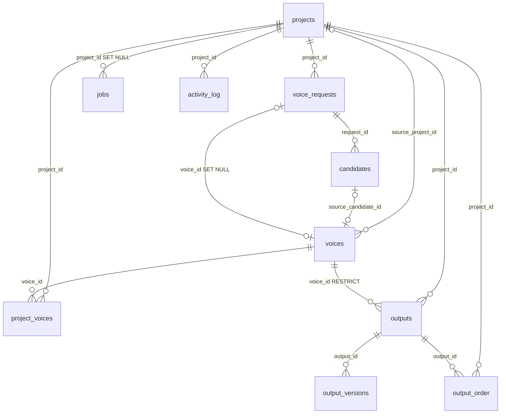

# 数据库最终设计（schema v5 · 终版）

> 整合本次会话全部已拍板决策。这是**最终目标结构**，不含设计推演过程（过程见 `database-design.md`）。  
> 标注约定：**已定** = 本次已确认；**待确认** = 记录在案、需再拍板，不影响主链路。  
> 现状数据量（实测）：projects 15 / voice_requests 30 / candidates 82 / voices 47 / project_voices 21 / batch_items 101 / batch_item_versions 114 / supplement_lines 3 / activity_log 534。

## 0. 一句话范围

- 继续用 **SQLite 单库**（`app.db`，WAL + 外键开启），不动磁盘目录布局。
- 共 **11 张表**，三大产物来源（批量台词 / 补录单句 / 单句保留）合并为一张 `outputs`。
- 迁移**不引入第三方框架**：沿用 `database.py` 的自愈机制 + 一个幂等手写脚本 + `backup_snapshot`。

## 1. 主链路流程图

```
建项目 ──> 声线需求 ──> 生成候选 ──> 固化声线 ──> 台词配音 ──> 返修对比 ──> 排序导出
projects   voice_requests  candidates  voices       outputs      output_versions  output_order
                                   + project_voices  (origin=batch)
            （第 1 步）                      （第 2 步）    （第 3 步）        （第 4 步）

系统侧写（并行）：
  jobs          任务级：开始/完成/成功 N 条/失败 N 条
  activity_log  只记关键动作：固化 / 删除 / 导出
  app_settings  只留 schema_version、last_project_id
```


## 2. 最终 DDL（11 张表）

```sql
-- ---------- 项目域 ----------
CREATE TABLE projects (
    id          TEXT PRIMARY KEY,
    name        TEXT NOT NULL UNIQUE,
    status      TEXT NOT NULL DEFAULT 'draft'
                CHECK (status IN ('draft','active','archived','deleted')),
    export_dir  TEXT,                          -- 原 batch_export_dir:<pid>
    notes       TEXT NOT NULL DEFAULT '',
    created_at  TEXT NOT NULL,
    updated_at  TEXT NOT NULL
);

CREATE TABLE project_voices (                  -- 项目「阵容」：已定、可配音
    project_id   TEXT NOT NULL REFERENCES projects(id) ON DELETE CASCADE,
    voice_id     TEXT NOT NULL REFERENCES voices(id) ON DELETE CASCADE,
    display_name TEXT NOT NULL,                -- 项目内别名
    position     INTEGER NOT NULL DEFAULT 0,   -- 项目内排序（v5 新增）
    created_at   TEXT NOT NULL,
    PRIMARY KEY (project_id, voice_id),
    UNIQUE (project_id, display_name),
    UNIQUE (project_id, position)
);
-- 复合主键索引只在 project_id 前缀下可用；删声线按 voice_id 找子行，缺此索引会全表扫
CREATE INDEX idx_project_voices_voice ON project_voices(voice_id);

-- ---------- 声线域 ----------
CREATE TABLE voices (                          -- 全局资产库
    id                  TEXT PRIMARY KEY,
    name                TEXT NOT NULL,
    source              TEXT NOT NULL
                        CHECK (source IN ('voice_design','upload')),
    prompt              TEXT,                   -- 音色自然语言描述
    language            TEXT NOT NULL,          -- 试听文本语种
    ref_language        TEXT NOT NULL DEFAULT '',-- 参考音频语种（纯标注）
    ref_text            TEXT,
    x_vector_only       INTEGER NOT NULL DEFAULT 0,  -- 从 metadata.json 提升
    reference_wav       TEXT NOT NULL,
    reference_hash      TEXT,
    reference_ms        INTEGER,                -- 素材时长
    preview_mp3         TEXT NOT NULL,
    prompt_path         TEXT NOT NULL,
    tags                TEXT NOT NULL DEFAULT '',
    notes               TEXT NOT NULL DEFAULT '',
    status              TEXT NOT NULL DEFAULT 'active'
                        CHECK (status IN ('active','replaced')),
    source_project_id   TEXT REFERENCES projects(id) ON DELETE SET NULL,
    source_candidate_id TEXT REFERENCES candidates(id) ON DELETE SET NULL,  -- 血缘
    created_at          TEXT NOT NULL,
    updated_at          TEXT NOT NULL
);
CREATE UNIQUE INDEX idx_voices_hash ON voices(reference_hash) WHERE status='active';

CREATE TABLE voice_requests (                  -- 第 1 步「声线需求单」，一行一个待定角色
    id              TEXT PRIMARY KEY,
    project_id      TEXT NOT NULL REFERENCES projects(id) ON DELETE CASCADE,
    position        INTEGER NOT NULL,
    name            TEXT NOT NULL,
    prompt          TEXT NOT NULL DEFAULT '',
    audition_text   TEXT NOT NULL DEFAULT '',
    language        TEXT NOT NULL,
    status          TEXT NOT NULL DEFAULT 'draft'
                    CHECK (status IN ('draft','ready','candidate','selected','single','fixed')),
    candidate_round INTEGER NOT NULL DEFAULT 0,
    voice_id        TEXT REFERENCES voices(id) ON DELETE SET NULL,  -- 补齐外键
    created_at      TEXT NOT NULL,
    updated_at      TEXT NOT NULL,
    UNIQUE (project_id, name)
);
-- direct_output_mp3 / direct_candidate_id 已移除，单句成品进 outputs（origin='single'）
-- 注：status 枚举保留 'single' 仅为兼容存量，新逻辑不再写它。

CREATE TABLE candidates (
    id           TEXT PRIMARY KEY,
    request_id   TEXT NOT NULL REFERENCES voice_requests(id) ON DELETE CASCADE,
    seed         INTEGER,
    round        INTEGER NOT NULL DEFAULT 0,
    selected     INTEGER NOT NULL DEFAULT 0,
    shortlisted  INTEGER NOT NULL DEFAULT 0,
    wav_path     TEXT NOT NULL,
    preview_path TEXT NOT NULL,
    params       TEXT,                          -- 生成参数 JSON（design_id、模型版本等）
    created_at   TEXT NOT NULL
);

-- ---------- 音频产物域（batch + supplement + single 三源合一） ----------
CREATE TABLE outputs (
    id          TEXT PRIMARY KEY,
    project_id  TEXT NOT NULL REFERENCES projects(id) ON DELETE CASCADE,
    voice_id    TEXT REFERENCES voices(id) ON DELETE RESTRICT,  -- 可空：单句保留时尚未固化
    voice_name  TEXT NOT NULL DEFAULT '',        -- 导出快照，防改名漂移
    origin      TEXT NOT NULL CHECK (origin IN ('batch','supplement','single')),
    position    INTEGER NOT NULL DEFAULT 0,      -- 项目内自然序
    text        TEXT NOT NULL,
    language    TEXT NOT NULL,
    gen_status  TEXT NOT NULL DEFAULT 'pending'
                CHECK (gen_status IN ('pending','running','done','failed')),
    in_final    INTEGER NOT NULL DEFAULT 0,      -- 是否选入成品（与生成状态解耦）
    output_mp3  TEXT,
    output_hash TEXT,
    duration_ms INTEGER,
    file_size   INTEGER,
    version     INTEGER NOT NULL DEFAULT 0,      -- 当前版本号
    error       TEXT,
    created_at  TEXT NOT NULL,
    updated_at  TEXT NOT NULL
);
CREATE INDEX idx_outputs_final  ON outputs(project_id, in_final, position);
CREATE INDEX idx_outputs_status ON outputs(project_id, gen_status);
CREATE INDEX idx_outputs_voice  ON outputs(voice_id);

CREATE TABLE output_versions (                  -- 版本历史，留最近 3 版（VERSIONS_KEPT=3）
    id          TEXT PRIMARY KEY,
    output_id   TEXT NOT NULL REFERENCES outputs(id) ON DELETE CASCADE,
    version     INTEGER NOT NULL,
    output_mp3  TEXT NOT NULL,
    output_hash TEXT,
    text        TEXT NOT NULL DEFAULT '',
    created_at  TEXT NOT NULL,
    UNIQUE (output_id, version)
);

CREATE TABLE output_order (                     -- 替代 output_order:<pid> JSON
    project_id TEXT NOT NULL REFERENCES projects(id) ON DELETE CASCADE,
    output_id  TEXT NOT NULL REFERENCES outputs(id) ON DELETE CASCADE,
    position   INTEGER NOT NULL,
    PRIMARY KEY (project_id, output_id),
    UNIQUE (project_id, position)
);

-- ---------- 系统域 ----------
CREATE TABLE jobs (                            -- 后台任务历史（本次拍板做）
    id          TEXT PRIMARY KEY,
    kind        TEXT NOT NULL CHECK (kind IN ('candidate','batch','regen','supplement')),
    project_id  TEXT REFERENCES projects(id) ON DELETE SET NULL,
    status      TEXT NOT NULL CHECK (status IN ('running','done','failed','cancelled')),
    total       INTEGER NOT NULL DEFAULT 0,
    succeeded   INTEGER NOT NULL DEFAULT 0,
    failed      INTEGER NOT NULL DEFAULT 0,
    started_at  TEXT NOT NULL,
    finished_at TEXT
);
CREATE INDEX idx_jobs_project ON jobs(project_id, started_at DESC);

CREATE TABLE activity_log (                    -- 只记关键动作：固化 / 删除 / 导出（+ 清理上限）
    id          TEXT PRIMARY KEY,
    project_id  TEXT REFERENCES projects(id) ON DELETE CASCADE,
    entity_type TEXT NOT NULL CHECK (entity_type IN
                ('project','voice','voice_request','candidate','batch','supplement','output','job')),
    entity_id   TEXT,
    action      TEXT NOT NULL,
    detail      TEXT NOT NULL DEFAULT '',
    created_at  TEXT NOT NULL
);
CREATE INDEX idx_activity_project ON activity_log(project_id, created_at DESC);

CREATE TABLE app_settings (                    -- 瘦身：只留真全局 KV
    key        TEXT PRIMARY KEY,
    value      TEXT NOT NULL,
    updated_at  TEXT NOT NULL
);
```

## 3. 表间关系（只画键）



删除行为一览：项目删 → 槽位/清单/产物/排序/流水级联清空，`jobs` 与 `voices.source_project_id` 置空；声线删 → `outputs` **RESTRICT**（还有音频在用就不许删）、槽位/清单/血缘置空或级联。

## 4. 决策清单

### 已定

1. `projects` **不加** `last_step`；废弃 `last_step:<pid>` 键与对应接口，步次由 `infer_last_step()` 按数据推断。
2. `export_dir` 提升为 `projects` 列（原 `batch_export_dir:<pid>`）。
3. 成品顺序 `output_order:<pid>` JSON → `output_order` 表。
4. 三源产物合一 `outputs`，`origin` 区分；`gen_status` 与 `in_final` 解耦。
5. `output_versions` 保留策略沿袭 `VERSIONS_KEPT=3`；三源统一后补录/单句**首次获得版本历史**。
6. 补血缘 `voices.source_candidate_id`；`x_vector_only`、`reference_hash`、时长/大小等元数据落库。
7. 枚举加 CHECK、`voice_requests.voice_id` 补外键、删 `batch_items.output_wav` 死列。
8. `jobs` 落库；`activity_log` **只记关键动作（固化/删除/导出）+ 清理上限**，任务级事件归 `jobs`。
9. `project_voices` 补 `voice_id` 索引与 `position` 列。
10. `app_settings` 瘦身，只留 `schema_version`、`last_project_id`。
11. 迁移**不引入框架**（自愈 + 幂等脚本；将来需要再上 Alembic/yoyo）。

### 待确认

1. **路径改相对**（P1-8）：存量 233 条全绝对路径，换机/换目录即失效；倾向存 `DATA_DIR` 相对路径 + 读时统一 `resolve_path()`。
2. **`model_id` + `gen_params` 落库**（P1-9）：与 `seed` 构成"可复现四元组"；当前 `candidates.params` 已留位，`outputs` 尚未加。

## 5. 与现有表对照（合并来源）

| 新表                    | 由哪些旧表/键合并而来                                                              |
| --------------------- | ------------------------------------------------------------------------ |
| `outputs`             | `batch_items` + `supplement_lines` + `voice_requests.direct_output_mp3`  |
| `output_versions`     | `batch_item_versions`（三源统一）                                              |
| `output_order`        | `app_settings: output_order:<pid>`（JSON）                                 |
| `projects.export_dir` | `app_settings: batch_export_dir:<pid>`                                   |
| `jobs`                | 无（原进程内 `BackgroundJob`，不落库）                                              |
| `app_settings`（瘦身）    | 原 `app_settings` 去掉 `output_order:`/`last_step:`/`batch_export_dir:` 前缀键 |
