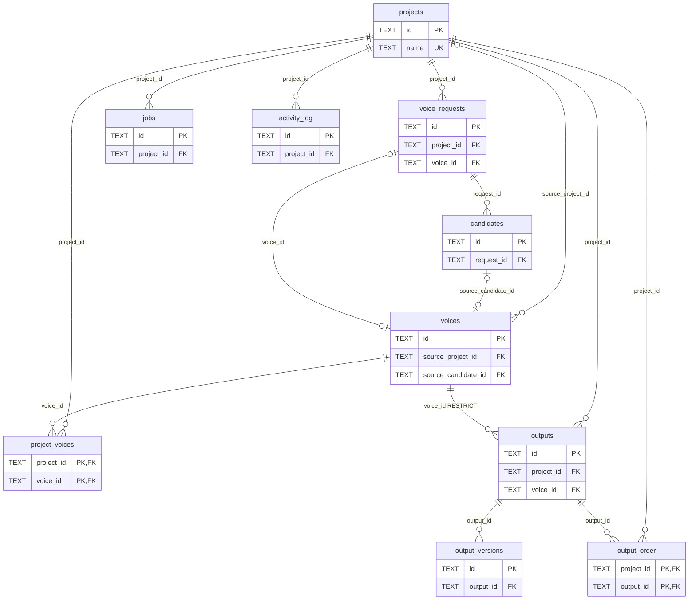

# 数据库数据字典（目标 schema v5）

> 本文只描述数据库本身：表名、主键、外键、唯一键、字段、表间关联。  
> 设计背景与迁移方案见 [database-design.md](./database-design.md)。  
> 库里所有表都是 **SQLite**，主键统一为 `TEXT`（uuid），时间统一为 ISO 8601 文本。

**标注约定**

| 标注 | 含义                             |
| -- | ------------------------------ |
| PK | 主键（Primary Key），唯一标识一行         |
| FK | 外键（Foreign Key），值必须存在于被指向表的主键中 |
| UK | 唯一键（Unique Key），该列/列组合不允许重复    |

> 你问的"副键"在数据库里没有标准定义，本文按两类列出：**外键 FK** 与 **唯一键 UK**。


---

## 一、表总览（11 张）

| #  | 表名                | 中文含义      | 主键 PK                          | 外键 FK                                                         | 唯一键 UK                                                  | 现有哪些表合并而来                                                               |
| -- | ----------------- | --------- | ------------------------------ | ------------------------------------------------------------- | ------------------------------------------------------- | ----------------------------------------------------------------------- |
| 1  | `projects`        | 项目        | `id`                           | —                                                             | `name`                                                  | `projects`                                                              |
| 2  | `project_voices`  | 项目声线清单    | `project_id` + `voice_id`（复合）  | `project_id`→projects、`voice_id`→voices                       | (`project_id`,`display_name`)、(`project_id`,`position`) | `project_voices`                                                        |
| 3  | `voices`          | 声线资产（全局库） | `id`                           | `source_project_id`→projects、`source_candidate_id`→candidates | `reference_hash`（仅 `status='active'` 时唯一）               | `voices`                                                                |
| 4  | `voice_requests`  | 工作台声线槽位   | `id`                           | `project_id`→projects、`voice_id`→voices                       | (`project_id`,`name`)                                   | `voice_requests`                                                        |
| 5  | `candidates`      | 候选试听      | `id`                           | `request_id`→voice_requests                                   | —                                                       | `candidates`                                                            |
| 6  | `outputs`         | 音频产物      | `id`                           | `project_id`→projects、`voice_id`→voices                       | —                                                       | `batch_items` + `supplement_lines` + `voice_requests.direct_output_mp3` |
| 7  | `output_versions` | 产物历史版本    | `id`                           | `output_id`→outputs                                           | (`output_id`,`version`)                                 | `batch_item_versions`                                                   |
| 8  | `output_order`    | 成品手动排序    | `project_id` + `output_id`（复合） | `project_id`→projects、`output_id`→outputs                     | (`project_id`,`position`)                               | `app_settings` 里的 `output_order:<pid>` JSON                             |
| 9  | `jobs`            | 后台任务历史    | `id`                           | `project_id`→projects                                         | —                                                       | 无（原来只在进程内存里）                                                            |
| 10 | `activity_log`    | 操作流水      | `id`                           | `project_id`→projects                                         | —                                                       | `activity_log`                                                          |
| 11 | `app_settings`    | 全局 KV 配置  | `key`                          | —                                                             | —                                                       | `app_settings`（瘦身后）                                                     |

---

## 二、表间关联（14 条外键关系）

### 2.1 以项目为中心

| # | 从表.字段                       | → 主表.字段       | 关系    | 删除项目时              |
| - | --------------------------- | ------------- | ----- | ------------------ |
| 1 | `voice_requests.project_id` | `projects.id` | 1 : N | 级联删除该项目的所有槽位       |
| 2 | `project_voices.project_id` | `projects.id` | 1 : N | 级联删除清单关联（不动声线资产）   |
| 3 | `outputs.project_id`        | `projects.id` | 1 : N | 级联删除该项目的所有音频产物     |
| 4 | `output_order.project_id`   | `projects.id` | 1 : N | 级联删除排序行            |
| 5 | `jobs.project_id`           | `projects.id` | 1 : N | 置空（任务历史保留）         |
| 6 | `activity_log.project_id`   | `projects.id` | 1 : N | 级联删除流水             |
| 7 | `voices.source_project_id`  | `projects.id` | 1 : N | 置空（声线是全局资产，不随项目消失） |

### 2.2 以声线为中心

| #  | 从表.字段                        | → 主表.字段         | 关系       | 删除声线时                   |
| -- | ---------------------------- | --------------- | -------- | ----------------------- |
| 8  | `project_voices.voice_id`    | `voices.id`     | 1 : N    | 级联删除各项目清单里的该项           |
| 9  | `outputs.voice_id`           | `voices.id`     | 1 : N    | 禁止删除（RESTRICT）——还有音频在用它 |
| 10 | `voice_requests.voice_id`    | `voices.id`     | 1 : 0..1 | 置空（槽位退回未固化）             |
| 11 | `voices.source_candidate_id` | `candidates.id` | 1 : 0..1 | 置空（血缘断了但声线保留）           |

### 2.3 以产物与流程为中心

| #  | 从表.字段                       | → 主表.字段             | 关系    | 删除时      |
| -- | --------------------------- | ------------------- | ----- | -------- |
| 12 | `candidates.request_id`     | `voice_requests.id` | 1 : N | 级联删除候选   |
| 13 | `output_versions.output_id` | `outputs.id`        | 1 : N | 级联删除版本历史 |
| 14 | `output_order.output_id`    | `outputs.id`        | 1 : N | 级联删除排序行  |

### 2.4 关联链路（怎么从项目走到音频）

```
projects ──< voice_requests ──< candidates ──┐
   │                                          │ 血缘（固化来源）
   ├──< project_voices >── voices <───────────┘
   │                        │
   ├──< outputs >───────────┘（voice_id，可为空：单句保留时尚未固化）
   │       └──< output_versions
   ├──< output_order >── outputs
   ├──< jobs
   └──< activity_log
```

---

## 三、逐表字段清单

### 3.1 `projects` — 项目（7 字段）

| 字段           | 类型   | 键      | 约束 / 默认值                                                              | 说明                                 |
| ------------ | ---- | ------ | --------------------------------------------------------------------- | ---------------------------------- |
| `id`         | TEXT | **PK** | NOT NULL                                                              | 项目 id（uuid）                        |
| `name`       | TEXT | **UK** | NOT NULL、UNIQUE                                                       | 项目名，全局唯一                           |
| `status`     | TEXT |        | NOT NULL，DEFAULT `'draft'`，CHECK ∈ (draft, active, archived, deleted) | 软删除靠 `deleted`                     |
| `export_dir` | TEXT |        | 可空                                                                    | 本机导出目录（原 `batch_export_dir:<pid>`） |
| `notes`      | TEXT |        | NOT NULL，DEFAULT `''`                                                 | 备注                                 |
| `created_at` | TEXT |        | NOT NULL                                                              | 创建时间                               |
| `updated_at` | TEXT |        | NOT NULL                                                              | 更新时间                               |

### 3.2 `project_voices` — 项目声线清单（5 字段）

| 字段             | 类型      | 键               | 约束 / 默认值                                         | 说明       |
| -------------- | ------- | --------------- | ------------------------------------------------ | -------- |
| `project_id`   | TEXT    | **PK** + **FK** | NOT NULL，→ `projects.id` ON DELETE CASCADE       | 项目       |
| `voice_id`     | TEXT    | **PK** + **FK** | NOT NULL，→ `voices.id` ON DELETE CASCADE         | 声线资产     |
| `display_name` | TEXT    |                 | NOT NULL，UK(`project_id`,`display_name`)         | 项目内显示名   |
| `position`     | INTEGER |                 | NOT NULL，DEFAULT `0`，UK(`project_id`,`position`) | 清单内的显式排序 |
| `created_at`   | TEXT    |                 | NOT NULL                                         | 加入清单时间   |

> 复合主键 = 一个声线在同一项目里只能出现一次。
>
> **定位澄清**：这张表是项目的「阵容」——**已经定下来、可以拿去配音**的那几把声音，不是"这个项目里出现过的所有声线"。工作台第 1 步看到的待定角色在 `voice_requests`（3.4），固化后才写进这里。所以同一项目里两个数字通常不相等：`流浪月亮` 需求单 7 个、阵容 1 个；`红楼梦` 6 个、阵容 4 个；`神雕侠侣` 2 个、阵容 0 个。
>
> 也不能用 `voices.project_id` 代替它：全库 47 把声线里只有 14 把挂进了项目，33 把纯库存；另有 6 把被 2–3 个项目共用（如 `贾宝玉克隆林黛玉` 出现在 3 个项目），一对多装不下。两列合起来是**一个**主键，不是两个；且这两列同时又是外键——PK 与 FK 是两套正交的分类，同一列可以兼任。另需 `idx_project_voices_voice`：复合主键的索引只在 `project_id` 前缀下可用，按 `voice_id` 删子行时用不上。

### 3.3 `voices` — 声线资产（21 字段）

| 字段                    | 类型      | 键      | 约束 / 默认值                                               | 说明                              |
| --------------------- | ------- | ------ | ------------------------------------------------------ | ------------------------------- |
| `id`                  | TEXT    | **PK** | NOT NULL                                               | 声线 id                           |
| `name`                | TEXT    |        | NOT NULL                                               | 声线名称（库内可重名）                     |
| `source`              | TEXT    |        | NOT NULL，CHECK ∈ (voice_design, upload)                | 来源：文字描述设计 / 上传音频                |
| `prompt`              | TEXT    |        | 可空                                                     | 音色自然语言描述（voice_design 用）        |
| `language`            | TEXT    |        | NOT NULL                                               | 试听文本语种                          |
| `ref_language`        | TEXT    |        | NOT NULL，DEFAULT `''`                                  | 参考音频语种                          |
| `ref_text`            | TEXT    |        | 可空                                                     | 参考音频对应文字                        |
| `x_vector_only`       | INTEGER |        | NOT NULL，DEFAULT `0`                                   | 是否仅用 x-vector（原在 metadata.json） |
| `reference_wav`       | TEXT    |        | NOT NULL                                               | 参考音频路径                          |
| `reference_hash`      | TEXT    | **UK** | 可空；仅 `status='active'` 时唯一                             | 参考音频 MD5，全局去重                   |
| `reference_ms`        | INTEGER |        | 可空                                                     | 参考音频时长（毫秒）                      |
| `preview_mp3`         | TEXT    |        | NOT NULL                                               | 试听文件路径                          |
| `prompt_path`         | TEXT    |        | NOT NULL                                               | 克隆 prompt（safetensors）路径        |
| `tags`                | TEXT    |        | NOT NULL，DEFAULT `''`                                  | 标签（逗号分隔）                        |
| `notes`               | TEXT    |        | NOT NULL，DEFAULT `''`                                  | 备注                              |
| `status`              | TEXT    |        | NOT NULL，DEFAULT `'active'`，CHECK ∈ (active, replaced) | 重新固化后旧资产置 `replaced`            |
| `source_project_id`   | TEXT    | **FK** | 可空，→ `projects.id` ON DELETE SET NULL                  | 来源项目（声线不属于项目）                   |
| `source_candidate_id` | TEXT    | **FK** | 可空，→ `candidates.id` ON DELETE SET NULL                | 从哪个候选固化来的（血缘）                   |
| `created_at`          | TEXT    |        | NOT NULL                                               | 创建时间                            |
| `updated_at`          | TEXT    |        | NOT NULL                                               | 更新时间                            |

### 3.4 `voice_requests` — 工作台声线槽位（12 字段）

| 字段                | 类型      | 键      | 约束 / 默认值                                                                              | 说明         |
| ----------------- | ------- | ------ | ------------------------------------------------------------------------------------- | ---------- |
| `id`              | TEXT    | **PK** | NOT NULL                                                                              | 槽位 id      |
| `project_id`      | TEXT    | **FK** | NOT NULL，→ `projects.id` ON DELETE CASCADE                                            | 所属项目       |
| `position`        | INTEGER |        | NOT NULL                                                                              | 工作表内排序     |
| `name`            | TEXT    |        | NOT NULL，UK(`project_id`,`name`)                                                      | 槽位名称，项目内唯一 |
| `prompt`          | TEXT    |        | NOT NULL，DEFAULT `''`                                                                 | 音色描述       |
| `audition_text`   | TEXT    |        | NOT NULL，DEFAULT `''`                                                                 | 试听文本       |
| `language`        | TEXT    |        | NOT NULL                                                                              | 试听语种       |
| `status`          | TEXT    |        | NOT NULL，DEFAULT `'draft'`，CHECK ∈ (draft, ready, candidate, selected, single, fixed) | 槽位状态机      |
| `candidate_round` | INTEGER |        | NOT NULL，DEFAULT `0`                                                                  | 当前候选轮次     |
| `voice_id`        | TEXT    | **FK** | 可空，→ `voices.id` ON DELETE SET NULL                                                   | 固化后指向声线资产  |
| `created_at`      | TEXT    |        | NOT NULL                                                                              | 创建时间       |
| `updated_at`      | TEXT    |        | NOT NULL                                                                              | 更新时间       |

### 3.5 `candidates` — 候选试听（10 字段）

| 字段             | 类型      | 键      | 约束 / 默认值                                         | 说明                        |
| -------------- | ------- | ------ | ------------------------------------------------ | ------------------------- |
| `id`           | TEXT    | **PK** | NOT NULL                                         | 候选 id                     |
| `request_id`   | TEXT    | **FK** | NOT NULL，→ `voice_requests.id` ON DELETE CASCADE | 所属槽位                      |
| `seed`         | INTEGER |        | 可空                                               | 随机种子                      |
| `round`        | INTEGER |        | NOT NULL，DEFAULT `0`                             | 第几轮生成                     |
| `selected`     | INTEGER |        | NOT NULL，DEFAULT `0`                             | 是否选定                      |
| `shortlisted`  | INTEGER |        | NOT NULL，DEFAULT `0`                             | 是否暂存                      |
| `wav_path`     | TEXT    |        | NOT NULL                                         | 候选音频路径                    |
| `preview_path` | TEXT    |        | NOT NULL                                         | 候选试听路径                    |
| `params`       | TEXT    |        | 可空                                               | 生成参数 JSON（design_id、模型版本） |
| `created_at`   | TEXT    |        | NOT NULL                                         | 创建时间                      |

### 3.6 `outputs` — 音频产物（18 字段）

| 字段            | 类型      | 键      | 约束 / 默认值                                                              | 说明                 |
| ------------- | ------- | ------ | --------------------------------------------------------------------- | ------------------ |
| `id`          | TEXT    | **PK** | NOT NULL                                                              | 产物 id              |
| `project_id`  | TEXT    | **FK** | NOT NULL，→ `projects.id` ON DELETE CASCADE                            | 所属项目               |
| `voice_id`    | TEXT    | **FK** | 可空，→ `voices.id` ON DELETE RESTRICT                                   | 使用的声线（单句保留时可能尚未固化） |
| `voice_name`  | TEXT    |        | NOT NULL，DEFAULT `''`                                                 | 声线名快照，导出不随改名漂移     |
| `origin`      | TEXT    |        | NOT NULL，CHECK ∈ (batch, supplement, single)                          | 来源：批量 / 补录 / 单句保留  |
| `position`    | INTEGER |        | NOT NULL，DEFAULT `0`                                                  | 项目内自然序             |
| `text`        | TEXT    |        | NOT NULL                                                              | 台词文本               |
| `language`    | TEXT    |        | NOT NULL                                                              | 生成语种               |
| `gen_status`  | TEXT    |        | NOT NULL，DEFAULT `'pending'`，CHECK ∈ (pending, running, done, failed) | 生成状态               |
| `in_final`    | INTEGER |        | NOT NULL，DEFAULT `0`                                                  | 是否选入成品（与生成状态解耦）    |
| `output_mp3`  | TEXT    |        | 可空                                                                    | 成品音频路径             |
| `output_hash` | TEXT    |        | 可空                                                                    | 成品 MD5，可对账         |
| `duration_ms` | INTEGER |        | 可空                                                                    | 时长（毫秒）             |
| `file_size`   | INTEGER |        | 可空                                                                    | 文件字节数              |
| `version`     | INTEGER |        | NOT NULL，DEFAULT `0`                                                  | 当前版本号              |
| `error`       | TEXT    |        | 可空                                                                    | 失败原因               |
| `created_at`  | TEXT    |        | NOT NULL                                                              | 创建时间               |
| `updated_at`  | TEXT    |        | NOT NULL                                                              | 更新时间               |

### 3.7 `output_versions` — 产物历史版本（7 字段）

| 字段            | 类型      | 键      | 约束 / 默认值                                  | 说明       |
| ------------- | ------- | ------ | ----------------------------------------- | -------- |
| `id`          | TEXT    | **PK** | NOT NULL                                  | 版本行 id   |
| `output_id`   | TEXT    | **FK** | NOT NULL，→ `outputs.id` ON DELETE CASCADE | 所属产物     |
| `version`     | INTEGER |        | NOT NULL，UK(`output_id`,`version`)        | 版本号      |
| `output_mp3`  | TEXT    |        | NOT NULL                                  | 该版本音频路径  |
| `output_hash` | TEXT    |        | 可空                                        | 该版本 MD5  |
| `text`        | TEXT    |        | NOT NULL，DEFAULT `''`                     | 该版本使用的文本 |
| `created_at`  | TEXT    |        | NOT NULL                                  | 生成时间     |

### 3.8 `output_order` — 成品手动排序（3 字段）

| 字段           | 类型      | 键               | 约束 / 默认值                                   | 说明              |
| ------------ | ------- | --------------- | ------------------------------------------ | --------------- |
| `project_id` | TEXT    | **PK** + **FK** | NOT NULL，→ `projects.id` ON DELETE CASCADE | 项目              |
| `output_id`  | TEXT    | **PK** + **FK** | NOT NULL，→ `outputs.id` ON DELETE CASCADE  | 产物              |
| `position`   | INTEGER |                 | NOT NULL，UK(`project_id`,`position`)       | 成品页展示序号（导出编号来源） |

### 3.9 `jobs` — 后台任务历史（9 字段）

| 字段            | 类型      | 键      | 约束 / 默认值                                               | 说明    |
| ------------- | ------- | ------ | ------------------------------------------------------ | ----- |
| `id`          | TEXT    | **PK** | NOT NULL                                               | 任务 id |
| `kind`        | TEXT    |        | NOT NULL，CHECK ∈ (candidate, batch, regen, supplement) | 任务类型  |
| `project_id`  | TEXT    | **FK** | 可空，→ `projects.id` ON DELETE SET NULL                  | 所属项目  |
| `status`      | TEXT    |        | NOT NULL，CHECK ∈ (running, done, failed, cancelled)    | 任务状态  |
| `total`       | INTEGER |        | NOT NULL，DEFAULT `0`                                   | 总条数   |
| `succeeded`   | INTEGER |        | NOT NULL，DEFAULT `0`                                   | 成功条数  |
| `failed`      | INTEGER |        | NOT NULL，DEFAULT `0`                                   | 失败条数  |
| `started_at`  | TEXT    |        | NOT NULL                                               | 开始时间  |
| `finished_at` | TEXT    |        | 可空                                                     | 结束时间  |

### 3.10 `activity_log` — 操作流水（7 字段）

| 字段            | 类型   | 键      | 约束 / 默认值                                                                                    | 说明           |
| ------------- | ---- | ------ | ------------------------------------------------------------------------------------------- | ------------ |
| `id`          | TEXT | **PK** | NOT NULL                                                                                    | 流水 id        |
| `project_id`  | TEXT | **FK** | 可空，→ `projects.id` ON DELETE CASCADE                                                        | 所属项目（全局操作为空） |
| `entity_type` | TEXT |        | NOT NULL，CHECK ∈ (project, voice, voice_request, candidate, batch, supplement, output, job) | 操作对象类型       |
| `entity_id`   | TEXT |        | 可空                                                                                          | 操作对象 id      |
| `action`      | TEXT |        | NOT NULL                                                                                    | 动作描述         |
| `detail`      | TEXT |        | NOT NULL，DEFAULT `''`                                                                       | 细节           |
| `created_at`  | TEXT |        | NOT NULL                                                                                    | 发生时间         |


### 3.11 `app_settings` — 全局 KV 配置（3 字段）

| 字段           | 类型   | 键      | 约束 / 默认值 | 说明                                        |
| ------------ | ---- | ------ | -------- | ----------------------------------------- |
| `key`        | TEXT | **PK** | NOT NULL | 配置键（如 `schema_version`、`last_project_id`） |
| `value`      | TEXT |        | NOT NULL | 配置值（字符串）                                  |
| `updated_at` | TEXT |        | NOT NULL | 更新时间                                      |

> 只放"孤立配置值"。成品顺序、导出目录、工作台步次都不在这里（分别进 `output_order` 表、`projects.export_dir`、不落库）。
>
> 三列各自的定位：`key` 是配置名（主键即命名空间，所以 `last_step:<pid>` 这种"前缀 + 参数"的写法天然没有约束）；`value` 是**唯一的载荷列**，类型统一 TEXT，装数字、uuid、JSON 都长一个样——库既不知道类型，也不知道结构；`updated_at` 由 `set_setting()` 的 `ON CONFLICT DO UPDATE` 维护，**目前代码里没有任何地方读它**，纯排障用。
>
> v5 只保留 2 个真正的全局键：`schema_version`（库自身版本，必须与 DDL 变更同事务）与 `last_project_id`（本机最后打开的项目）。

---

## 四、关系图（只画键）



---

## 五、关键约束速查

| 约束                                            | 位置                                                                                                                             | 作用               |
| --------------------------------------------- | ------------------------------------------------------------------------------------------------------------------------------ | ---------------- |
| `UNIQUE(name)`                                | projects                                                                                                                       | 项目名不重复           |
| `UNIQUE(project_id, name)`                    | voice_requests                                                                                                                 | 同项目槽位不重名         |
| `UNIQUE(project_id, display_name)`            | project_voices                                                                                                                 | 同项目清单显示名不重名      |
| `UNIQUE(project_id, position)`                | project_voices / output_order                                                                                                  | 清单与成品顺序不重复       |
| `UNIQUE(output_id, version)`                  | output_versions                                                                                                                | 版本号不重复           |
| 部分唯一索引 `reference_hash WHERE status='active'` | voices                                                                                                                         | 同一段参考音频只能有一个有效声线 |
| `CHECK` 枚举                                    | projects.status、voices.source/status、voice_requests.status、outputs.origin/gen_status、jobs.kind/status、activity_log.entity_type | 非法取值直接拒绝写入       |
| `ON DELETE RESTRICT`                          | outputs.voice_id                                                                                                               | 还有音频在用，声线不许删     |
| `ON DELETE SET NULL`                          | voices.source_project_id / source_candidate_id、voice_requests.voice_id、jobs.project_id                                         | 主记录删了，从记录保留但断开   |
| `ON DELETE CASCADE`                           | 其余外键                                                                                                                           | 主记录删了，从记录一起清     |
